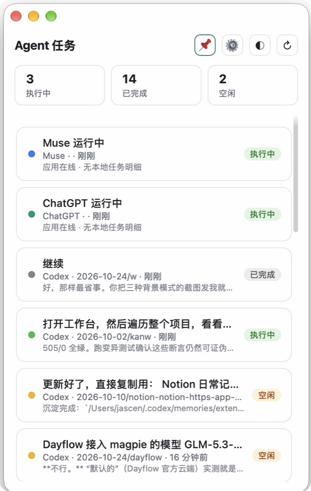
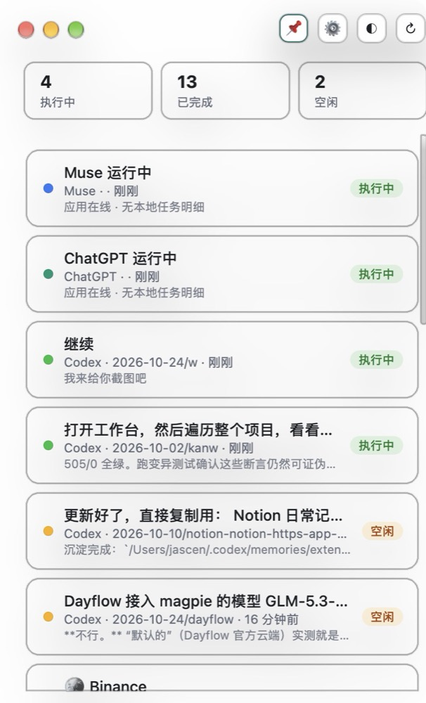
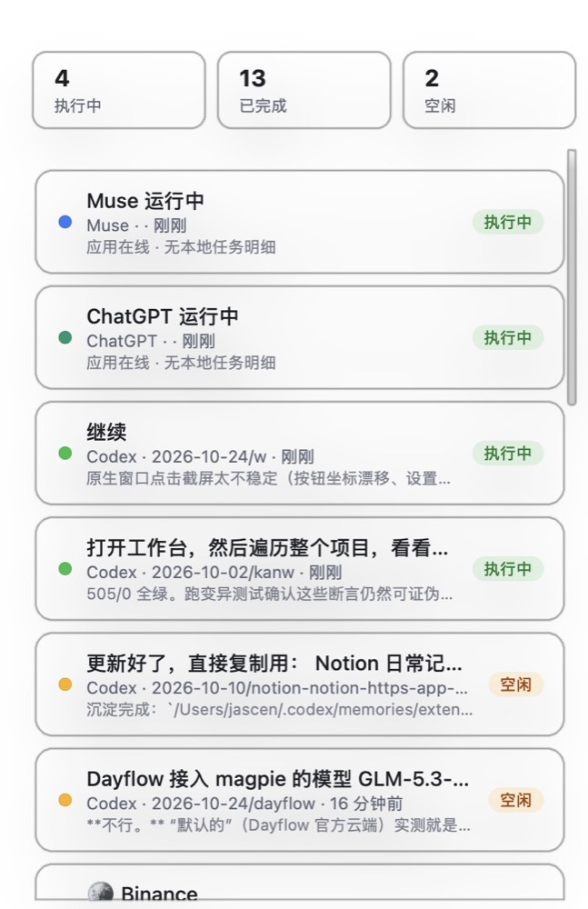

<div align="center">

# AgentTaskPanel

### 一块悬浮面板，看清你所有 AI Agent 的任务状态

**Codex 跑到哪了？Claude Code 完成了没？**<br>
不用再挨个窗口翻。一块常驻面板实时聚合本机所有 Agent 的会话状态，<br>
任务结束自动通知，点卡片直接跳回对应的 Agent。

[](https://github.com/Jascenn/agent-task-panel/releases/latest)
[](https://github.com/Jascenn/agent-task-panel/stargazers)
[](LICENSE)


**[下载最新版](https://github.com/Jascenn/agent-task-panel/releases/latest)** · [功能](#功能) · [支持的 Agent](#支持的-agent) · [从源码构建](#从源码构建)

| 磨砂模式 | 纯色模式 | 透明模式 |
|---|---|---|
|  |  |  |

</div>

## 安装

1. 从 [Releases](https://github.com/Jascenn/agent-task-panel/releases/latest) 下载 `AgentTaskPanel-v0.2.0.dmg`
2. 打开 DMG，把 🤖 AgentTaskPanel 拖进旁边的 Applications 文件夹
3. 首次启动会请求通知权限，允许即可

就这样。本地数据服务随 App 自动启动，菜单栏会出现 🤖 图标，实时显示执行中的任务数。

> App 使用 ad-hoc 签名（无付费开发者证书）。首次打开若提示「无法验证开发者」，右键点击 App → 打开，或到 系统设置 → 隐私与安全性 → 点「仍要打开」。

## 功能

- **实时状态**：会话文件 120 秒内有写入 = 执行中；有完成标记 = 已完成；其余 = 空闲
- **菜单栏常驻**：🤖 图标显示执行中数量，菜单可快速唤起面板 / 切置顶 / 刷新数据 / 退出
- **三态筛选**：点顶部统计卡筛选执行中/已完成/空闲，再点取消
- **三色指示灯**：任务前圆点区分渠道（Codex 蓝 / Claude 紫 / Muse 青绿 …），一眼认出来源
- **三态背景**：毛玻璃 → 全透明 → 纯色；透明模式下红绿灯和所有按钮自动隐藏，鼠标移入浮现
- **置顶悬浮**：📌 开关，悬浮在所有窗口（含全屏 Space）之上
- **渠道配置**：⚙️ 勾选哪些渠道显示/隐藏，保存到 `~/.agent-panel-config.json`
- **任务跳转**：点卡片通过 URL scheme 跳回对应 Agent（codex://、cue:// 等）
- **完成通知**：任务从执行中变已完成时发系统通知
- **开机自启**：设置菜单一键开关，通过 LaunchAgent 实现

## 支持的 Agent

| Agent | 状态 | 任务详情 | 数据来源 |
|---|---|---|---|
| Codex | ✅ 完整 | ✅ 最近对话/进展 | `~/.codex/sessions` JSONL |
| Claude Code | ✅ 完整 | ✅ 最近回复 | `~/.claude/projects` JSONL |
| Cue | ✅ 完整 | ✅ 实时工作文本 | `~/Library/Application Support/Cue/SessionStore/sessions.sqlite` |
| Grok Bot | ✅ 完整 | ✅ 会话最近消息 | `~/Library/Application Support/Grok Bot/sand-client-persistence/*.blob` |
| Muse | ⚠️ 在线状态 | ❌ 任务在服务端执行 | 进程检测 |
| ChatGPT | ⚠️ 在线状态 | ❌ 任务在服务端执行 | 进程检测 |
| Today / Noi | ⚠️ 在线状态 | ❌ 任务在服务端执行 | 进程检测 |

完整支持 = 读取本地会话文件，能显示真实任务标题和最近内容。

## 从源码构建

```bash
git clone https://github.com/Jascenn/agent-task-panel.git
cd agent-task-panel
zsh build.sh
open AgentTaskPanel.app
```

要求：macOS 13+，Xcode Command Line Tools（`xcode-select --install`）。

也可以直接浏览器打开面板：本地服务运行在 `http://127.0.0.1:8765`，所有数据都留在本机，不上传任何内容。

## 配置文件

`~/.agent-panel-config.json`（面板 ⚙️ 菜单可视化配置）：

```json
{ "hidden": ["today", "noi"] }
```

## 数据读取范围

面板只读以下本地路径，用于推断会话状态，不做任何写操作、不上传任何数据：

```
~/.codex/sessions/
~/.claude/projects/
~/Library/Application Support/Cue/SessionStore/
~/Library/Application Support/Grok Bot/sand-client-persistence/
```

## 已知限制

- Muse / ChatGPT 等服务端执行的 Agent 只能显示"应用在线"，任务明细在服务端、本地无数据
- 会话标题取自首条用户消息，注入的系统上下文（AGENTS.md 等）已自动过滤
- App 暂未做签名和公证（需要 Apple 开发者账号），后续计划接入

## 开发者文档

构建、签名、发布新版本的完整流程见 [docs/BUILD-RELEASE.md](docs/BUILD-RELEASE.md)。

## License

[MIT](LICENSE) © 2026 Jascenn
