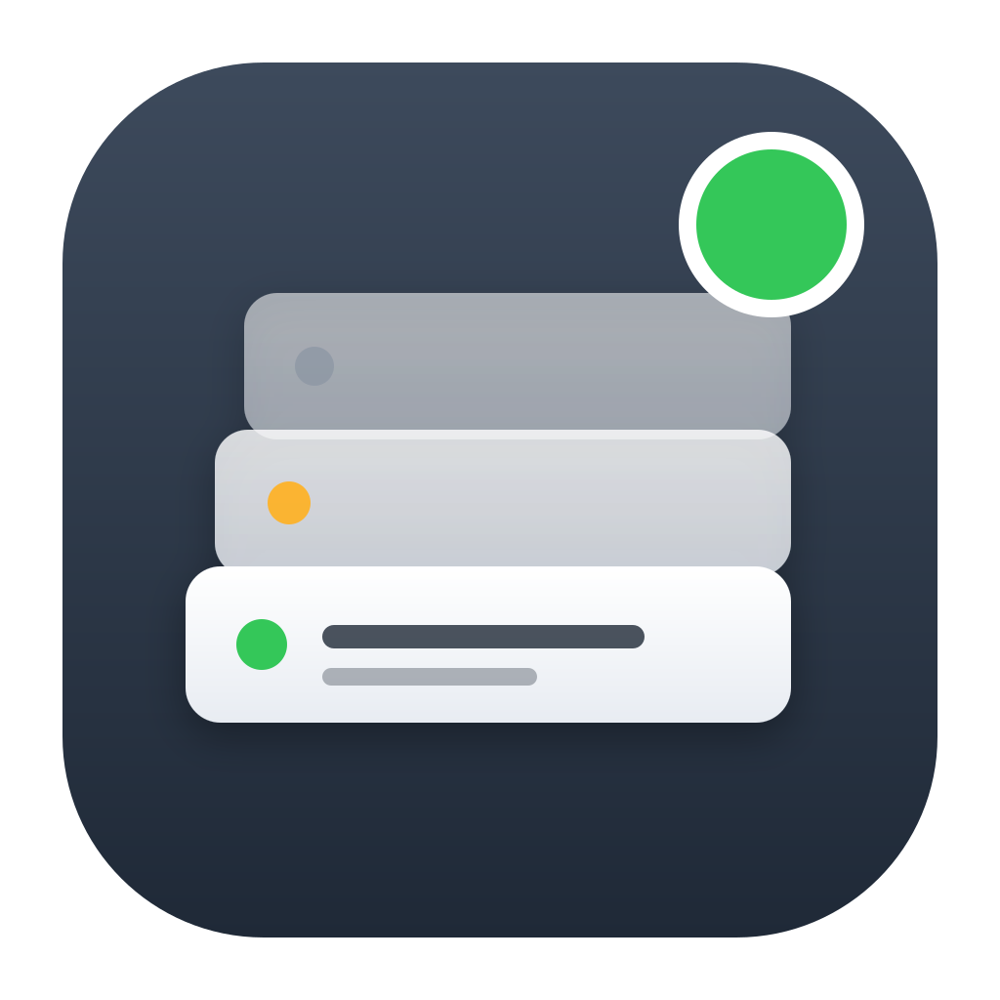
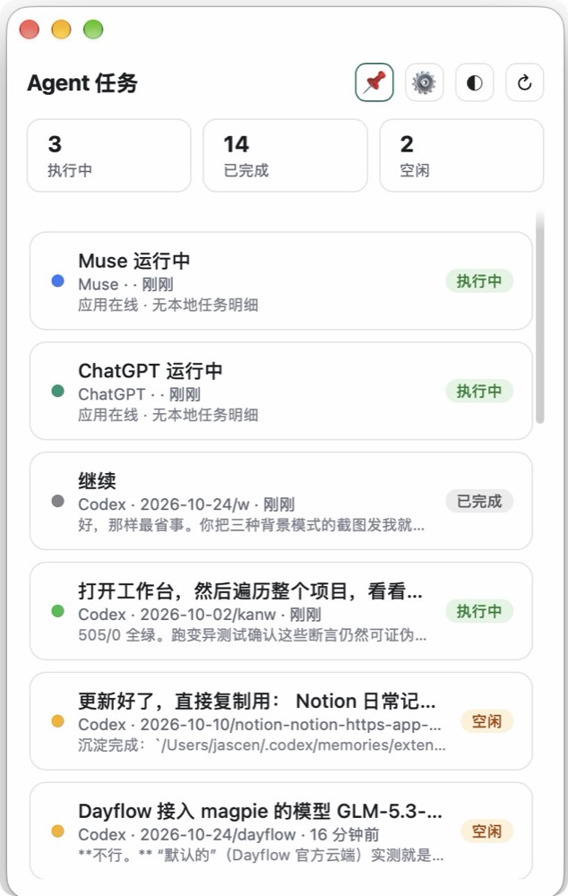

<div align="center">



# AgentTaskPanel

### One floating panel for every AI Agent's task status

**Where is Codex? Did Claude Code finish?**<br>
Stop alt-tabbing. One always-on panel aggregates every AI agent's session state on your Mac —<br>
you get a notification when a task finishes, and clicking a card jumps straight back to that agent.

[](https://github.com/Jascenn/agent-task-panel/releases/latest)
[](https://github.com/Jascenn/agent-task-panel/stargazers)
[](LICENSE)


**[Download](https://github.com/Jascenn/agent-task-panel/releases/latest)** · [Features](#features) · [Supported apps](#supported-apps) · [Build from source](#build-from-source) · [简体中文](README.zh-CN.md)

| Frost | Solid | Clear |
|---|---|---|
|  |  |  |

</div>

## Install

1. Grab the latest `AgentTaskPanel-vX.Y.Z.dmg` from [Releases](https://github.com/Jascenn/agent-task-panel/releases/latest)
2. Open the DMG and drag 🤖 AgentTaskPanel into the Applications folder next to it
3. Allow notifications on first launch — done

The local data service starts with the app, and a 🤖 menu bar item shows how many tasks are running right now. An install guide (English & 中文) is included inside the DMG.

> The app is ad-hoc signed (no paid Apple certificate). If macOS says it "cannot be verified": right-click the app → Open, or run `xattr -dr com.apple.quarantine /Applications/AgentTaskPanel.app`.

## Features

- **Live status**: a session file written within the last 120 s = running; a completion marker = done; otherwise idle
- **Menu bar item**: monochrome template icon with a live running-task count; menu offers show panel / pin / launch-at-login / refresh / quit
- **Crash-proof data service**: a watchdog health-checks the local API every 5 s and silently relaunches it if it dies
- **Three-state filters**: click a stat card to filter running / done / idle, click again to clear
- **Per-agent color dots**: each task carries its agent's accent color, so you can tell sources apart at a glance
- **Three background modes**: frost → clear → solid; in clear mode the traffic lights and buttons auto-hide and reappear on hover
- **Pin-to-top**: 📌 keeps the panel floating above everything, including full-screen Spaces
- **Channel visibility**: ⚙️ toggle which apps appear, saved to `~/.agent-panel-config.json`
- **Jump back**: click a card to open the agent via its URL scheme (`codex://`, `cue://`, …)
- **Finish notifications**: a system notification fires when a task transitions running → done
- **Launch at login**: one toggle in the menu, implemented as a LaunchAgent

## Supported apps

**Coding agents** (real session detail from local files):

| Agent | Status | Detail | Data source |
|---|---|---|---|
| Codex | ✅ Full | ✅ recent prompts / progress | `~/.codex/sessions` JSONL |
| Claude Code | ✅ Full | ✅ recent reply | `~/.claude/projects` JSONL |
| Cue | ✅ Full | ✅ live working text | `~/Library/Application Support/Cue/SessionStore/sessions.sqlite` |
| Grok Bot | ✅ Full | ✅ session last message | `~/Library/Application Support/Grok Bot/sand-client-persistence/*.blob` |

**Chat agents**:

| Agent | Status | Detail | Data source |
|---|---|---|---|
| Today | ✅ Full | ✅ last chat title + activity | `~/Library/Application Support/ai.today.macos.app/chat_*.sqlite` |
| Muse | ⚠️ Online only | ❌ sessions live on the vendor's server | process detection |
| ChatGPT | ⚠️ Online only | ❌ sessions live on the vendor's server | process detection |

**Other AI apps** (monitored for convenience, not agents):

| App | Status | Detail | Data source |
|---|---|---|---|
| Noi | ⚠️ Online only | ❌ it's a browser, no task concept | process detection |

"Full" = the panel reads local session files and shows real task titles plus recent activity.

## Privacy

The panel only **reads** the paths listed above to infer session state. It never writes to them, never uploads anything, and works fully offline. The only network endpoint is `127.0.0.1:8765` — its own local API.

## Build from source

```bash
git clone https://github.com/Jascenn/agent-task-panel.git
cd agent-task-panel
zsh build.sh
open AgentTaskPanel.app
```

Requires macOS 13+ and Xcode Command Line Tools (`xcode-select --install`).

You can also open the panel in a browser at `http://127.0.0.1:8765`.

## Configuration

`~/.agent-panel-config.json` (editable via the panel's ⚙️ menu):

```json
{ "hidden": ["today", "noi"] }
```

## Known limitations

- Muse / ChatGPT execute tasks server-side, so only "app online" can be shown — no local task detail exists
- Session titles come from the first user message; injected system context (AGENTS.md etc.) is filtered out
- The app is ad-hoc signed; Developer ID signing + notarization is planned once there's an Apple developer account

## Docs

Build, signing and release workflow: [docs/dev/BUILD-RELEASE.zh-CN.md](docs/dev/BUILD-RELEASE.zh-CN.md) (中文)

## License

[MIT](LICENSE) © 2026 Jascenn
