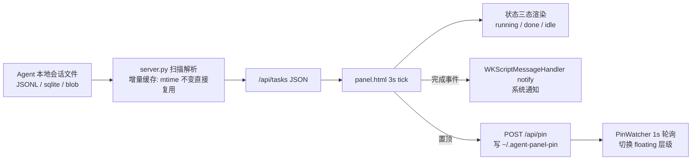

# 架构说明

## 三层架构

```
AgentTaskPanel.app（Swift NSPanel 外壳）
├── PanelController       NSPanel + WKWebView，加载 http://127.0.0.1:8765/
├── MenuBarManager        NSStatusItem 菜单栏图标（执行中数量，10s 轮询）
├── ChromeHost            红绿灯显隐控制（透明模式全隐藏，鼠标移入浮现）
├── PinWatcher            1s 轮询 ~/.agent-panel-pin，切换 floating 层级
├── ServerKeeper          5s 探活，server.py 意外退出自动拉起
├── DragView              顶部 40px 拖动条（hitTest 放行按钮区）
├── NavDelegate           拦截 codex:// 等自定义 scheme 交给系统打开
└── DockMenuDelegate      Dock 菜单 + 开机自启（LaunchAgent）
        │
        └── 启动时拉起 bundle 内 server.py（127.0.0.1:8765）
            ├── scan_codex()   ~/.codex/sessions/**/*.jsonl
            ├── scan_claude()  ~/.claude/projects/**/*.jsonl
            ├── scan_cue()     Cue SessionStore/sessions.sqlite
            ├── scan_grok()    Grok Bot sand-client-persistence/*.blob
            ├── scan_apps()    Today chat_*.sqlite（真实明细）+ 其余进程检测
            └── tasks()        合并 → 排序 → 按渠道配置过滤
                    │
                    └── panel.html（单文件前端，server 同源提供）
                        3s tick / 状态筛选 / 渠道色点 / 完成通知 / 背景三态
```

Swift 只做 native 不可替代的部分（窗口/菜单栏/通知/拖动），数据解析用 Python 快速迭代，前端复用 Web 技能、单文件零构建。

## 数据流



## 关键设计决策

| 决策 | 理由 |
|---|---|
| server 同源提供页面 | file:// 加载页面后 fetch 127.0.0.1 被跨域拦，同源直接解决 |
| 状态判定 = 文件 mtime 推断（120s 窗口） | 非侵入，不需要 Agent 配合上报；有边界误差但可接受 |
| 置顶用标志文件而非直接 API | 页面 📌 按钮和 native 状态解耦，PinWatcher 轮询对齐双方 |
| swiftc + 脚本构建，不用 Xcode 工程 | 项目小（~1.3k 行），工程文件是负担 |
| 面板标题取首条用户消息 + 黑名单过滤 | 会话文件里全是注入内容（AGENTS.md/system-reminder），clean_title 过滤后才可读 |
| ad-hoc 签名 | 无开发者证书；解决浏览器下载后"文件已损坏"问题 |

## 安全边界

数据服务只绑定 `127.0.0.1:8765`，无鉴权——依赖"仅本地回环"作为边界，不要改为 0.0.0.0 监听。

## 引用文件

- `src/main.swift`
- `src/server.py`
- `resources/panel.html`
- `scripts/build.sh`
